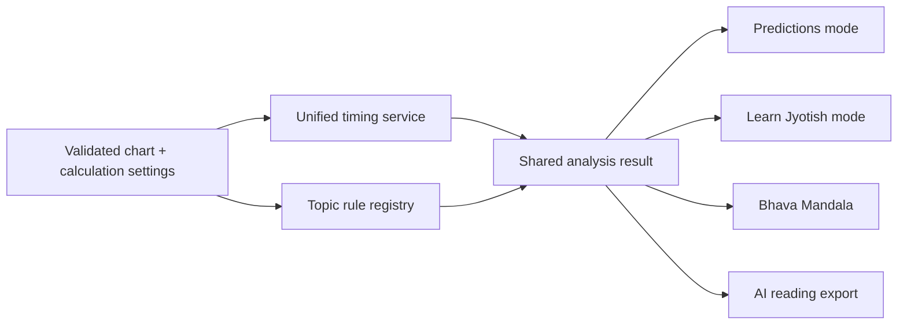

# Jyotish Atlas product rebuild

## Product decision

Jyotish Atlas has two modes that share the same selected chart, date, settings and evidence:

1. **Predictions** answers a practical question: what is active now, what life area is involved, what supports the reading, and what to explore next.
2. **Learn Jyotish** teaches the rules behind the reading in a paced journey and preserves the reference tools for deeper study.

The first screen is Predictions. Learning is always one tap away and never requires the user to re-enter a chart.

## Experience principles

- Start with one decision: create, import, or open a chart.
- Keep the current period, its dates, and the active life themes visible before advanced tables.
- Explain every conclusion with chart-specific evidence. Generic strength labels are insufficient on their own.
- Treat D-1 as promise and the relevant varga as delivery. Keep the applicable varga in context rather than hiding it in a separate tool.
- Show a compact reading first, with progressive disclosure for houses, planets, aspects, SAV/BAV and source rules.
- Keep desktop and mobile on the same routes, state and language. On small screens, show reading before diagram and turn wide tables into an explicit secondary view.
- Use restrained typography, clear hierarchy, generous spacing, decisive primary actions, visible states and no decorative card clutter. These are the Impeccable `distill`, `onboard`, `adapt`, `harden`, `clarify` and `polish` themes applied to this product.

## Product architecture

The shared analysis result must contain facts, rule IDs, supporting evidence, conflicting evidence, timing intervals, calculation settings and provenance. Views must never independently calculate a verdict.

## Delivery sequence

### Phase 1 — establish trust

- [x] Add an explicit Predictions / Learn Jyotish entry point.
- [x] Make chart creation the primary first action.
- [x] Preserve chart context when moving between the two modes.
- [ ] Compare production and checked-out source at a pinned commit.
- [ ] Publish the calculation contract: ephemeris, ayanamsha, node model, house system, dasha year convention, timezone handling and divisional-chart methods.
- [ ] Build reference fixtures for longitudes, ascendant, dashas, vargas and SAV/BAV.
- [ ] Fix interval semantics: every period is `[start, end)`.

### Phase 2 — one timing core

- [ ] Normalize imported and calculated dashas into one schema, including pratyantardashas and provenance.
- [ ] Replace midpoint-only transit scoring with interval-aware transit events.
- [ ] Introduce an explicit analysis date used by every prediction surface.
- [ ] Remove fixed forecast horizons from UI and prompt generation.
- [ ] Split job events into offer, joining, promotion, internal move and exit.

### Phase 3 — one explanation core

- [ ] Build versioned rules for each topic and divisional chart.
- [ ] Return evidence and contradictions alongside every reading.
- [ ] Use the same result for the Life Predictor, Bhava Mandala, outlook, dasha panel and prompt export.
- [ ] Rework scores into interpretable evidence weights; avoid pseudo-precise certainty labels.

### Phase 4 — complete the experience

- [ ] Predictions home: active phase, question picker, short answer, evidence and next window.
- [ ] Bhava Mandala: area → personal reading → occupants/ruler/aspects → SAV/BAV → timing.
- [ ] D10: career-specific house labels and a narrative that includes planet and source-house aspects.
- [ ] AI reading export: question, context, time horizon, reviewed facts, calculation settings and privacy preview.
- [ ] Mobile parity, keyboard access, empty/error states, export/import and visual regression checks.

## Release gates

1. **Calculation gate:** fixtures match the documented settings; known disagreements are shown to the user.
2. **Consistency gate:** the same chart, date and question yields identical period facts across all views.
3. **Usability gate:** a first-time user can create/import a chart, read the current phase and open a house explanation without guidance.
4. **Mobile gate:** no horizontal page overflow, no hover-only control, and the prediction path works at 360 px and desktop widths.
5. **Trust gate:** every prediction identifies its evidence, its unresolved contradictions and the engine/rule version used.

## First increment in this change

This change establishes the visible product shell: an explicit mode switch, a prediction-first home, clear chart entry actions, active dasha dates when data exists, and direct paths to the Bhava Mandala, question flow and learning journey. It deliberately does not claim to repair the dasha engine; that work begins with the calculation contract and fixtures above.
